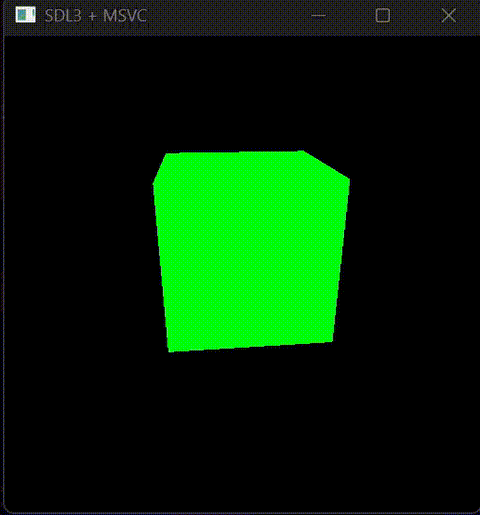
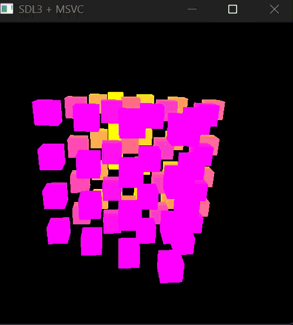
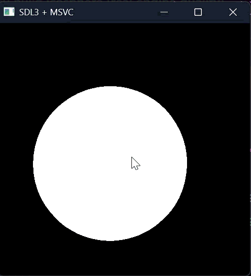
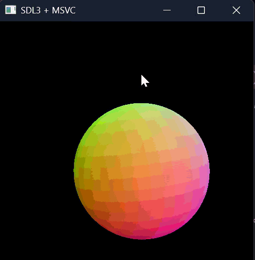

# 🎮 Pixel Renderer


A small software renderer built to understand how graphics actually work.

## 🔲 Cube Rendering Demo

<p align="center">
  
  
</p>

---

## 🔵 Sphere Rendering Demo

<p align="center">
  
  
</p>

<p align="center">
  <sub>Left: Low resolution sphere | Right: Higher resolution / improved shading</sub>
</p>
## ✨ What it does

- 🎥 Free 6-DOF camera movement + rotation (Perspective & Orthographic)  
- 🔺 2D & 3D triangle rasterization using barycentric coordinates  
- 🧊 Indexed mesh rendering (`Mesh`, `MeshFactory::CreateCube`, `MeshFactory::CreateSphere`)  
- 🛡️ Perspective-correct depth buffering (Z-buffer) with 1/w interpolation  
- ✂️ Object-level AABB frustum culling and screen-space back-face culling  
- 🎨 Material & custom shader support (`DebugShader`, `ZDebugShader`)  
- ⏱️ Built-in Tracy profiler telemetry and rolling average FPS / frame time tracking  
- 🧠 Pure software rendering pipeline (manual, CPU-based, no GPU rasterization)  

---

## 🎯 Why this exists

To learn:
- how 3D → 2D projection works  
- how cameras behave  
- how triangles become pixels  

---

## 🚧 Current limits

- No dynamic lighting (Phong / Blinn-Phong models)  
- No `.obj` mesh loader yet (in progress)  
- No near-plane polygon clipping (currently triangle rejection)  
- No texture mapping (UV interpolation)  
- Single-threaded CPU rasterization (no multithreading / SIMD yet)  

---
## Renderer Benchmark

### Scene
- Entities: 216
- Resolution: 512 × 512
- Camera: Perspective, 60° FOV
- Culling: Frustum + Back-face
- Animation: Continuous orbital rotation

### Current Baseline

| Metric | Result |
|---|---:|
| Frames | 779 |
| Average Frame Latency | **73.415 ms** |
| Minimum Latency | **0.384 ms** |
| Maximum Latency | **2712.139 ms** |
| Total Triangles | **2,019,168** |
| Drawn Triangles | **222,757** |
| Frustum Culls | **84,220** |
| Back-face Culls | **245,890** |

> Benchmark measures the `RenderMesh()` calls only. SDL texture upload and presentation are outside the measured region.
### Milestone 1 — Object-Level Frustum Culling

| Metric | Result |
|---|---:|
| Frames | 1885 |
| Average Frame Latency | **32.611 ms** |
| Minimum Latency | **0.090 ms** |
| Maximum Latency | **143.987 ms** |
| Total Triangles | **996,768** |
| Drawn Triangles | **430,821** |
| Frustum Culls | **74,494** |
| Back-face Culls | **491,115** |

> Milestone 1 adds object-level frustum culling before triangle processing. Benchmark measures the `RenderMesh()` calls only. SDL texture upload and presentation are outside the measured region.

---

## ⚙️ Building

### Requirements
- C++23 compatible compiler (MSVC 2022 / Clang-cl)
- CMake 3.10+
- Windows (SDL3 and Tracy are bundled)

### CMake
```bash
cmake -B build
cmake --build build --config Release
.\build\Release\pixel_ppm.exe
```

Or run the provided batch scripts:
```bash
compile.bat   # Builds Debug configuration
run.bat       # Runs the executable
```
